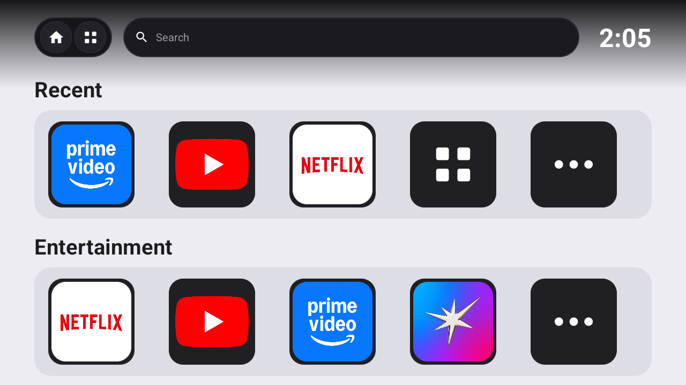
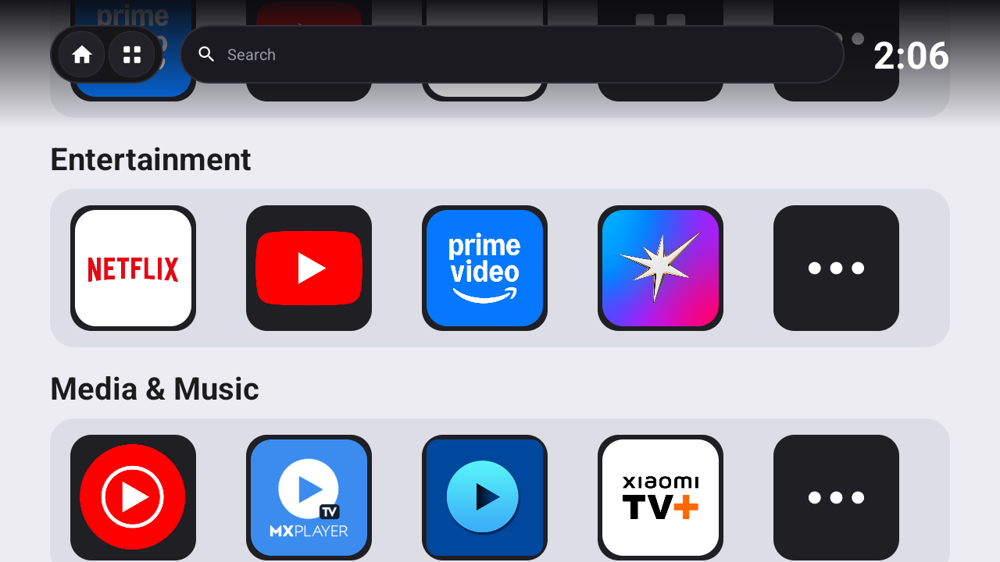

# Basic Home (Base Home: Genesis)

[](https://github.com/akshraj2022/basichome/releases)
[](https://developer.android.com/tv)
[](LICENSE)

An ultra-optimized, zero-bloat, ad-free Android TV Leanback launcher meticulously crafted for low-RAM and weak GPU devices (tested on Acer P Series 42" AR42AP2841FD - Cortex-A53, Mali-470 GPU, 1.5 GB RAM).

---

## Visual Showcase

| Home View (Sleek Top Bar & Ambient Scrim) | Focused Row Navigation |
|---|---|
|  |  |

| Search Navigation | Rows Gliding Under Ambient Scrim |
|---|---|
|  |  |

---

## Key Features

1. **Upper Bar in Black & Gray Shades**:
   - Modern dark charcoal pill (`#161619`) with subtle slate borders (`#2C2C34`).
   - High-contrast button focus states with a 2dp crisp white focus ring (`#FFFFFF`).
   - Integrated digital clock in bold pure white.

2. **Always-On Ambient Gradient Scrim**:
   - Layered `FrameLayout` architecture where rows smoothly glide underneath the top bar.
   - Smooth linear falloff starting at maximum density (`#F50C0C10`, 96% opacity) at the top and seamlessly tapering to 0% opacity at 124dp.
   - Terminates cleanly at the active section title ("Recent"), keeping row headings and tiles 100% bright and crisp.

3. **Curved Squircle Play Store Icons**:
   - Authentic official Play Store app icons scaled up to fill 124dp tile boxes.
   - Anti-aliased 18% squircle curvature via `RoundedBitmapDrawableFactory`.
   - Ultra-HD 512x512 master icons scraped directly from Google's Play CDN and cached permanently on device storage.

4. **Custom Matching Settings Icon**:
   - Handcrafted slate squircle card with silver/white mechanical gear and cyan accent hub.

5. **7 Organized TV Categories**:
   - **Recent**: Dynamic recently launched applications.
   - **Entertainment**: Top video streaming platforms (Netflix, YouTube, Prime Video, Hotstar, JioCinema, SonyLIV, etc.).
   - **Media & Music**: YouTube Music, MX Player TV, USB Media Player, Xiaomi TV+, Google TV Movies.
   - **Games**: Dedicated games shelf (Beach Buggy Racing, Ludo King, etc.).
   - **Tools & VPN**: Proton VPN, Windscribe VPN, FastScreen, AirCast TV.
   - **System**: Custom Settings card, Google Play Store, TV Manager, Google Assistant.
   - **Inputs**: Hardware TV passthrough inputs (HDMI 1, HDMI 2, AV) via `TvInputManager`.

6. **Infallible Bidirectional D-Pad Navigation**:
   - Up from Recent row tiles 0–1 focuses **All Apps**; tiles 2–4 focus **Search**.
   - Down from All Apps focuses tile 0; down from Search focuses tile 2 (aligned vertically).
   - Down from the bottom row stays put; left/right bounds do not wrap.
   - Smooth auto-centering on active rows with clearance under the top bar.

7. **Solar Astronomical Day/Night Themes**:
   - Automatically calculates sunrise & sunset locally from the TV timezone and day of year.
   - Switches between sleek daytime canvas and pitch dark cinema canvas, keeping the upper bar permanently in sleek black & gray shades.

---

## Performance Metrics

| Metric | Target | Measured |
|---|---|---|
| **APK Size** | < 5.0 MB | **~3.2 MB** |
| **Idle RAM Usage** | < 70 MB | **~38–48 MB** |
| **Cold Start Time** | < 1.5 s | **~0.8 s** |
| **Frame Rate** | 60 FPS | **Solid 60 FPS** (Hardware Accelerated) |

---

## Installation & Setup

### 1. Download Release
Download the latest `BasicHome-v1.0.0.apk` from [Releases](https://github.com/akshraj2022/basichome/releases).

### 2. Install via Wireless ADB
Connect to your Android TV (enable Developer Options & Network Debugging in Settings):
```bash
adb connect <TV_IP_ADDRESS>:5555
adb install -r BasicHome-v1.0.0.apk
```

### 3. Launch
```bash
adb shell am start -n com.minimal.tvlauncher/.MainActivity
```

### 4. (Optional) Set as Default Home Launcher
```bash
adb shell cmd package set-home-activity com.minimal.tvlauncher/.MainActivity
```

### 5. (Optional) Disable Bloatware Stock Google TV Launcher
```bash
adb shell pm disable-user --user 0 com.google.android.apps.tv.launcherx
```

---

## Build from Source

### Prerequisites
- JDK 17 (e.g., from Android Studio `jbr`)
- Android SDK 34

### Build Command
```bash
./gradlew assembleRelease
```
The compiled APK will be generated at:
`app/build/outputs/apk/release/app-release.apk`

---

## License

This project is licensed under the MIT License - see the [LICENSE](LICENSE) file for details.
